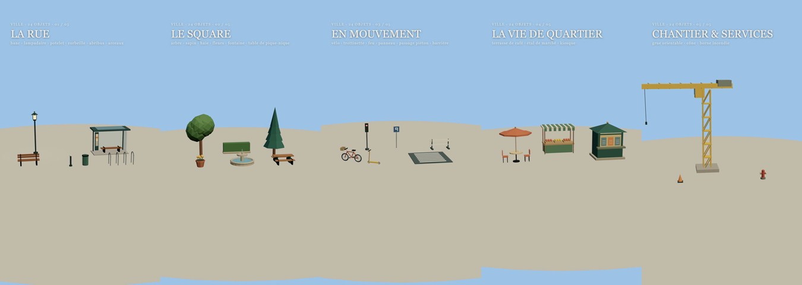

# What if… — vidéos verticales Remotion + Three.js

Vidéos TikTok/Shorts « Et si… ? » en 1080×1920, style low-poly à faces plates, avec voix
off générée localement (XTTS) et ambiance sonore procédurale. Un dossier par vidéo, une
bibliothèque 3D commune, des scripts classés par usage.

> Branche de travail : **`1.03-test2`**. Voir [l'état des versions](#versions) et
> [la feuille de route](AMELIORATIONS.md).

## Sommaire

1. [Installer](#1-installer)
2. [Lancer le Studio](#2-lancer-le-studio)
3. [Créer une vidéo, étape par étape](#3-créer-une-vidéo-étape-par-étape)
4. [Voix off XTTS](#4-voix-off-xtts)
5. [Rendre et vérifier](#5-rendre-et-vérifier)
6. [Les vidéos du dépôt](#6-les-vidéos-du-dépôt)
7. [Bibliothèque 3D](#7-bibliothèque-3d)
8. [Où chercher](#8-où-chercher)
9. [Versions](#versions) · [Améliorations](#améliorations)

## 1. Installer

Prérequis : Node 20+, et pour la voix Python 3.12 + (idéalement) une carte NVIDIA.

```powershell
npm install
```

Voix locale (facultatif, une seule fois) — détails dans [docs/voice.md](docs/voice.md) :

```powershell
python -m venv .venv
.\.venv\Scripts\python.exe -m pip install torch==2.6.0 torchaudio==2.6.0 --index-url https://download.pytorch.org/whl/cu124
.\.venv\Scripts\python.exe -m pip install -r scripts/audio/xtts/requirements.txt
```

Le modèle XTTS v2 (≈ 1,8 Go) est téléchargé au premier usage dans `.cache/`, jamais
dans le dossier utilisateur. Tous les chemins sont relatifs au projet : le dossier peut
être déplacé.

> **Après un déplacement du dossier**, `python.exe` du `.venv` continue de marcher (les
> scripts npm l'appellent directement), mais `pip.exe` garde l'ancien chemin. Utiliser
> `.\.venv\Scripts\python.exe -m pip …` au lieu de `pip`.

## 2. Lancer le Studio

```powershell
npm run dev
```

- **Videos** : toutes les compositions (dont `InternetOffV1`).
- **AudioFirst** : la chaîne « audio d'abord » (`AudioFirstBridge`).
- **Bibliotheque** : planches `Assets`, `AssetsInterieur`, `AssetsVille` pour choisir les objets.

## 3. Créer une vidéo, étape par étape

Le flux suivi pour `InternetOffV1` (« Et si Internet disparaissait… maintenant ? ») sert de modèle.

| Étape | Quoi | Où |
| --- | --- | --- |
| 1. Format | `fps`, `width`, `height`, `duration` | `src/videos/<slug>/timing.json` |
| 2. Texte et créneaux | une réplique = `{id, slot: [début, fin], text}` | `src/videos/<slug>/narration.json` |
| 3. Scène 3D | décor, personnages, **un plan de caméra par beat** (`SHOTS`) | `Scene3D.tsx` |
| 4. Habillage | HUD, textes, bulles, écran de fin | `Hud.tsx`, `TextOverlay.tsx` |
| 5. Composition | Canvas 3D + overlays + pistes audio | `<Slug>.tsx`, déclaré dans `src/Root.tsx` |
| 6. Voix + ambiance | génération XTTS calée sur les créneaux, puis ambiance | `scripts/audio/<slug>.py` |
| 7. Contrôle | images clés, puis rendu complet | `remotion still`, `npm run render:…` |

Règles qui évitent les mauvaises surprises :

- **Tout dépend du temps de la vidéo** (`useCurrentFrame()/fps`) : jamais `Date.now()`,
  `Math.random()` ni `useFrame`, sinon le rendu change d'une image à l'autre.
- **Un plan de caméra par moment du récit** : un seul plan large pendant 80 s ne raconte
  rien. Les coupes sont masquées par un fondu au noir très court (`CUTS`).
- **Le format est vertical** : le champ horizontal est étroit (≈ 33° à fov 55). Cadrer
  serré sur l'action, vérifier qu'aucun dos ou objet ne bouche l'avant-plan.
- **Pas de nappe de bruit continue** dans l'ambiance : préférer des sons ponctuels et de la
  musique. Mesurer le « fond » de chaque phase (voir étape 5).
- **Vérifier chaque réplique** par transcription : XTTS remplace parfois un mot.

Copier une base existante plutôt que partir de zéro :

```powershell
npm run video                              # catalogue des bases
npm run video -- copy nature-v2 mon-film   # copie indépendante du scénario
npm run video -- still mon-film
```

## 4. Voix off XTTS

```powershell
npm run voice:add -- ma-voix "C:\chemin\enregistrement.mp3"   # 10 s de référence propre
npm run voice:list
npm run voice:use -- ma-voix
```

Les références vocales restent dans `voice-samples/` et ne sont **jamais** versionnées.
Les pistes générées (`public/<slug>/*.wav`) non plus : elles se reconstruisent.

Pour `InternetOffV1` :

```powershell
npm run voice:internet     # 9 répliques XTTS + ambiance → public/internet-off/ et voice.json
npm run render:internet    # → out/internet-off/internet-off-v1.mp4
```

Le script met chaque réplique en cache (texte + voix + seed), ne régénère que ce qui a
changé, accélère au plus ×1,3 pour tenir dans le créneau et **échoue** au-delà : raccourcir
alors le texte ou changer la `seed` de la réplique dans `narration.json`.

## 5. Rendre et vérifier

```powershell
npm run validate        # scénarios : format, chemins, scènes, créneaux, affirmations à vérifier
npm run typecheck
npm run test:project    # copie d'une base, compilation, protection des sources
npm run test:voice      # profils vocaux (Python requis)
npx remotion still InternetOffV1 out/frame.png --frame=1095
```

Avant un rendu complet, rendre **une image au milieu de chaque plan** et les relire en
planche : c'est ce qui a révélé les plans bouchés, les têtes coupées et les textes illisibles.
Exports dans `out/` (non versionné).

## 6. Les vidéos du dépôt

| Composition | Dossier | Durée | Remarque |
| --- | --- | --- | --- |
| `InternetOffV1` | `src/videos/internet-off/` | 85 s | Nouvelle — voix XTTS, ambiance, 15 plans, HUD et CTA |
| `AudioFirstBridge` | `src/videos/audio-first-bridge/` | variable | Timeline compilée depuis l'audio aligné |
| `CafeCold`, `CafeColdV2` | `src/videos/cafe-cold*/` | ≈ 66 s | Images dérivées des durées mesurées de la voix |
| `BusCold` | `src/videos/bus-cold/` | ≈ 68 s | |
| `ParisPolar`, `ParisPolarV2` | `src/videos/paris-polar*/` | ≈ 68 s | |
| `NatureReprendV2`, `Gravite` | `nature-v2/`, `gravity/` | 50 / 55 s | Issues de la branche 1.01 |
| `WhatIf`, `NatureReprend`, `Chaleur` | `whatif/`, `nature/`, `heat/` | | Bases historiques |
| `WhatIfParisV2…V6`, `WhatIfParisTikTok` | `paris-*/` | | Variantes Paris |

## 7. Bibliothèque 3D

`src/assets/` — unités en mètres, origine au sol, façade vers −z, faces plates.

- Kit commun : `PAL`, `Block`, `Cyl`, `Ball`, `Mat`, `seeded` ([kit.tsx](src/assets/kit.tsx)).
- Bâtiments haussmanniens, maisons, voitures, bus, bateaux, tour Eiffel, personnages.
- [Collection Ville 1.02](src/assets/city/README.md) : 24 objets urbains, plus
  **`CityBase`**, une rue parisienne complète réutilisable (`seed`, `time`, `lit`, `eiffel`, `seine`).
- Nouveaux dossiers `buildings/`, `vehicles/`, `nature/`, `street/`, `humans/` et la palette
  [colors.ts](src/assets/colors.ts).
- 42 objets d'intérieur dans `src/assets/interior/`.
- Personnage expressif `Actor` (yeux, sourire, rire, tête/bras orientables, téléphone
  allumé/éteint) dans [internet-off/Actor.tsx](src/videos/internet-off/Actor.tsx) — à
  remonter dans `src/shared/` pour les prochaines vidéos.



### Éditeur de ville (HTML)

```powershell
npm run city        # → http://127.0.0.1:5199
```

- **Générer** un quartier à partir d'une graine : îlots haussmanniens, magasins, îlots modernes, squares, la Seine
  avec quais, ponts, péniches et bateaux-mouches, tours de bureaux et tour Eiffel à l'horizon.
- **Caméra réalisateur** (onglet Caméra) : 9 mouvements (vue d'ensemble 3/4, orbite, plongée, travelling, grue,
  piéton, contre-plongée, révélation, survol), « Capturer cette vue », cadre 9:16, lecture de la séquence.
  Les plans sont enregistrés avec la ville et filmés tels quels par `CityLayoutPreview`.
  Le guide de cadrage est dans le skill [camera-realisateur](.claude/skills/camera-realisateur/SKILL.md).
- **Catalogue** des 85 assets par catégorie, avec aperçu 3D qui tourne : cliquer puis cliquer dans la scène pour poser.
- **Déplacer** à la souris (clic pour sélectionner, puis glisser), **tourner** (R, Q/E), modifier les réglages
  (étages, largeur, couleurs, modèle…), dupliquer, supprimer, annuler (Ctrl+Z). Rues et trottoirs sont verrouillés
  par défaut (bouton **Sol**).
- **Enregistrer** écrit `public/city-layouts/<nom>.json`. Dans Remotion : composition `CityLayoutPreview`
  (prop `layout: "<nom>"`), ou dans une vidéo `useCityLayout('<nom>')` + `<LayoutScene layout={…} />`.

Le registre commun ([registry.tsx](src/assets/city/registry.tsx)) garantit le même rendu dans l'éditeur et dans la vidéo :
un nouvel asset ajouté au registre apparaît automatiquement dans le catalogue.

## 8. Où chercher

| Besoin | Dossier ou guide |
| --- | --- |
| Arborescence | [docs/structure.md](docs/structure.md) |
| Copier une base, reprendre un objet ou un script | [docs/reuse.md](docs/reuse.md) |
| Scénario d'une vidéo | [src/videos/catalog.json](src/videos/catalog.json) |
| Animations et calculs communs | `src/core/` |
| Caméra, ciel, globe, styles | `src/shared/` |
| Scripts audio, ressources, exports | `scripts/audio/`, `scripts/assets/`, `scripts/export/` |
| Voix locale XTTS | [docs/voice.md](docs/voice.md) |
| Historique détaillé | [docs/versions/](docs/versions/) |

## Versions

| Branche | Contenu |
| --- | --- |
| `main` / `1.03-test1` | Structure initiale (même commit `0f8cb9b`) |
| `1.01` | Nature V2, Gravité, objets extérieurs et intérieurs |
| `1.02` | Réorganisation `videos/` · `assets/` · `core/` · `shared/`, catalogue, XTTS multi-profils, 24 objets ville |
| **`1.03-test2`** | 1.02 + corrections de l'audit + chaîne audio-first, cafe/bus/polar, `CityBase`, `InternetOffV1` |

Détails : [docs/versions/1.03-test2.md](docs/versions/1.03-test2.md).

## Améliorations

Faites dans `1.03-test2` :

- Validation des scénarios avant rendu, cache d'ambiance par empreinte, scènes inconnues en erreur.
- `InternetOffV1` complète : voix XTTS vérifiée par transcription, ambiance sans souffle continu,
  mise en scène en 15 plans (foule sur téléphones, poignée de main, banc, feu de camp, carte, nuit).
- `CityBase` et nouveaux assets réutilisables.
- Dépôt vérifié après déplacement du dossier (chemins relatifs, modèle XTTS en cache local).

Prochaines étapes prioritaires (liste complète et critères dans [AMELIORATIONS.md](AMELIORATIONS.md)) :

1. Remonter `Actor` et le système de plans (`SHOTS`/`CUTS`) dans `src/shared/` pour les réutiliser.
2. Ajouter `internet-off` au catalogue pour qu'il profite de `npm run video` et du validateur.
3. Ancrer les bulles de dialogue sur les têtes (projection 3D → écran) au lieu de positions fixes.
4. Intégration continue : `npm ci` → `validate` → `typecheck` → `test:project` → stills.
5. Vérifier la licence XTTS (CPML) et le consentement des voix avant toute publication monétisée.
