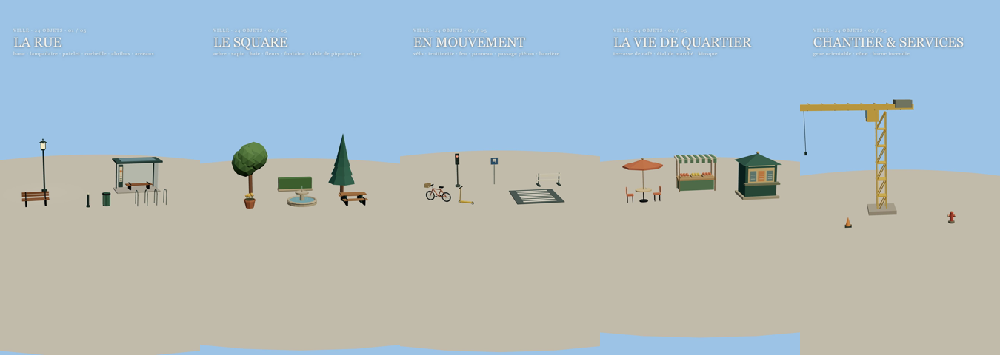

# What if… — vidéos verticales Remotion + Three.js

Vidéos TikTok / YouTube Shorts « Et si… ? » en 1080×1920 : scènes 3D low-poly à faces plates
rendues avec Remotion et Three.js, voix off générée localement (XTTS), ambiance sonore procédurale.
Personnage récurrent : **Marc** (avec Julien), dans une série d'épisodes de 40 à 85 s.

> Branche de travail : **`1.12`** ([notes](docs/versions/1.12.md)). `main` est protégée : on y fusionne
> par Pull Request une fois la CI verte. Feuille de route : [AMELIORATIONS.md](AMELIORATIONS.md).

Chaque section renvoie au **skill** du projet qui détaille la méthode (`.claude/skills/`, voir [Skills](#11-skills-du-projet)).

## Sommaire

1. [Démarrer](#1-démarrer)
2. [Les vidéos](#2-les-vidéos)
3. [Créer un épisode](#3-créer-un-épisode)
4. [Voix off et son](#4-voix-off-et-son)
5. [Vérifier et rendre](#5-vérifier-et-rendre)
6. [Améliorer la rétention](#6-améliorer-la-rétention)
7. [Faits et sources](#7-faits-et-sources)
8. [Publier](#8-publier)
9. [Code partagé](#9-code-partagé)
10. [Bibliothèque 3D et éditeur de ville](#10-bibliothèque-3d-et-éditeur-de-ville)
11. [Skills du projet](#11-skills-du-projet)
12. [Branches, CI et versions](#12-branches-ci-et-versions)

## 1. Démarrer

Prérequis : Node 20+ (la CI utilise Node 22), Git LFS pour les MP4 de `review/` ; pour la voix,
Python 3.12 et idéalement une carte NVIDIA.

```powershell
npm install
npm run dev          # Remotion Studio
```

Dossiers du Studio : **Videos** (toutes les compositions, dont la série Marc et `Couverture`),
**Videos-2-01** (finition visuelle 2.01), **AudioFirst** (`AudioFirstBridge`), **Bibliotheque**
(`Assets`, `AssetsVille`, `AssetsInterieur`, `AssetsDetails`, `Personnages`, aperçus de ville).

Voix locale (facultatif, une fois) — détails dans [docs/voice.md](docs/voice.md) :

```powershell
python -m venv .venv
.\.venv\Scripts\python.exe -m pip install torch==2.6.0 torchaudio==2.6.0 --index-url https://download.pytorch.org/whl/cu124
.\.venv\Scripts\python.exe -m pip install -r scripts/audio/xtts/requirements.txt
npm run venv:check   # après un déplacement du dossier : Python de base, paquets, lanceur pip
```

Le modèle XTTS v2 (≈ 1,8 Go) est téléchargé au premier usage dans `.cache/`. Les chemins sont relatifs :
le dossier peut être déplacé (`venv:check` dit comment réparer `pip` si besoin).

## 2. Les vidéos

| Composition | Dossier `src/videos/` | Durée | Titre public |
| --- | --- | --- | --- |
| `MarcGeant` | `marc-geant/` | 83 s | Et si Marc devenait géant ? |
| `MarcGeantCourt` | `marc-geant-court/` | 45 s | idem — pilote éditorial 1.11 monté à partir des plans de `MarcGeant` |
| `MarcMini` | `marc-mini/` | 85 s | Et si Marc rétrécissait ? |
| `MarcSoif` | `marc-soif/` | 81 s | Et si Marc ne buvait plus d'eau ? |
| `MarcFour` | `marc-four/` | 84 s | Et si Marc était enfermé dans un four ? |
| `MarcCongel` | `marc-congel/` | 85 s | Et si Marc était enfermé dans un congélateur ? |
| `MarcSalaire`, `MarcSalaire2`, `MarcSalaire3` | `marc-salaire*/` | 3 × 79 s | Et si Marc était payé pour ne rien faire ? (parties 2 et 3 sans titre public) |
| `MarcDeuxLunes` | `marc-deux-lunes/` | 84 s | Et si Marc voyait une deuxième lune ? |
| `AsteroideParis` | `asteroide-paris/` | 40 s | Et si un astéroïde tombait sur Paris ? |
| `InternetOffV1` | `internet-off/` | 85 s | Et si Internet disparaissait ? |
| `CafeCold`, `CafeColdV2`, `BusCold`, `ParisPolar`, `ParisPolarV2` | `cafe-cold*/`, `bus-cold/`, `paris-polar*/` | 66–68 s | « −10 °C par minute » |
| `AudioFirstBridge` | `audio-first-bridge/` | variable | timeline compilée depuis l'audio aligné |
| Bases du catalogue (`WhatIf`, `Chaleur`, `NatureReprend[V2]`, `Gravite`, `WhatIfParisV2…V6`, `WhatIfParisTikTok`) | voir [catalog.json](src/videos/catalog.json) | | rendues par `npm run video -- render <slug>` |

Rendus contrôlés et mesures : `review/1.10/` (tous les MP4) et `review/1.11/` (pilote), en Git LFS.

## 3. Créer un épisode

Skill [`nouvelle-video-marc`](.claude/skills/nouvelle-video-marc/SKILL.md), avec
[`whatif-ghostwriter`](.claude/skills/whatif-ghostwriter/SKILL.md) pour le texte et
[`camera-realisateur`](.claude/skills/camera-realisateur/SKILL.md) pour les plans.
Modèles : `marc-deux-lunes/` (rue, espace, extérieur) et `marc-congel/` (huis clos).

| Étape | Fichier | Contenu |
| --- | --- | --- |
| Format | `timing.json` | `{fps: 30, width: 1080, height: 1920, duration}` |
| Texte | `narration.json` | `{duration, beats: [{id, slot: [début, fin], text, seed?, source?}]}` |
| Scène | `Scene3D.tsx` | horloge du récit en constantes, décors, personnages, `SHOTS` via `src/shared/three/shots.ts` |
| Habillage | `Hud.tsx`, `TextOverlay.tsx` | compteurs, accroche, sous-titres, mention « scénario fictif », fin |
| Composition | `Marc<Sujet>.tsx` + `src/Root.tsx` | `ThreeCanvas`, calques, pistes audio de `voice.json` |
| Voix et ambiance | `scripts/audio/marc-<sujet>.py` | prises XTTS calées sur les créneaux, bruitages |
| Publication | `publication.json` | titre « Et si … ? », source, couverture, métriques |

Règles :

- **Tout dépend du temps de la vidéo** (`frame / fps`) : jamais `Date.now()`, `Math.random()` ni `useFrame`.
- **Écrire pour la rétention** : la première phrase pose la règle et le problème en ≤ 4 s ; ensuite
  problème → conséquence → escalade, pas une simple énumération ; une seule question à la fin.
- **Un plan par moment du récit**, coupes franches ; fondu au noir seulement aux vrais changements de
  temps, de lieu ou d'échelle.
- **Format vertical** : champ horizontal étroit (≈ 33° à fov 55), sujet entre 25 % et 70 % de la hauteur,
  rien devant l'objectif (caméra sur la chaussée, pas dans la file de stationnement), textes dans la zone
  sûre (`src/shared/ui/PlatformSafeArea.ts`).

Copier une ancienne base du catalogue : `npm run video -- copy nature-v2 mon-film`, puis
`npm run video -- still mon-film` (voir [docs/reuse.md](docs/reuse.md)).

## 4. Voix off et son

Skill [`voix-xtts`](.claude/skills/voix-xtts/SKILL.md).

> **Licence** : les poids XTTS v2 sont sous CPML, usage **non commercial** du modèle **et des WAV produits**.
> Une chaîne monétisée ou sponsorisée doit changer de voix ; consentement écrit de la personne dont la voix
> est clonée. Détails et modèle d'accord : [docs/legal/voix-et-licences.md](docs/legal/voix-et-licences.md).

```powershell
npm run voice:add -- ma-voix "C:\chemin\enregistrement.mp3"   # 10 s de référence propre
npm run voice:use -- ma-voix
npm run voice:marc-deux-lunes                                 # prises + ambiance → public/marc-deux-lunes/, voice.json
npm run captions -- marc-deux-lunes                           # transcription + sous-titres synchronisés
npm run audio:levels -- marc-deux-lunes                       # niveaux des répliques et de l'ambiance
```

- Chaque réplique est mise en cache (texte + voix + seed) ; accélération ≤ ×1,3, sinon le script **échoue** :
  raccourcir le texte.
- Mot mal prononcé : 4–5 prises avec d'autres `seed`, transcrire, garder la meilleure ; s'il rate partout,
  reformuler.
- Cibles : écart ≤ 3 LU entre répliques, ambiance baissée d'au moins 4 dB sous la voix, mix ≈ −16 LUFS,
  sons ponctuels plutôt qu'une nappe de bruit continue.
- GPU de 6 Go : si XTTS échoue au chargement (« out of memory » alors que la carte est libre), vérifier
  l'espace disque, puis `CUDA_VISIBLE_DEVICES=-1` force le CPU. Whisper utilise le GPU via les DLL de PyTorch.
- Les références vocales (`voice-samples/`) ne sont jamais versionnées ; les pistes des vidéos Marc
  (`public/marc-*`) le sont, celles des anciennes bases se reconstruisent.
- Bruitages : 38 effets synthétisés en code, sans fichier sous licence ni navigateur (`npm run sfx -- --list`,
  feuille `{duration, cues: [{t, sfx}]}` → WAV). Transitions `whip`, `zoom`, `flash` sur la scène 3D avec
  leurs sons : [docs/transitions-et-effets-sonores.md](docs/transitions-et-effets-sonores.md), démo **Transitions**.

## 5. Vérifier et rendre

Skill [`verification-rendu`](.claude/skills/verification-rendu/SKILL.md).

```powershell
npm test                                            # typage + tests + projet + validation
npm run stills -- MarcDeuxLunes --frames 60,500,1050,1500   # planche dans out/stills/<Composition>/
npm run editorial -- marc-deux-lunes                # sous-titres, CTA, plans, sources, audio → out/editorial-report.md
npm run render:marc-deux-lunes                      # MP4 dans out/marc-deux-lunes/
npm run audio:levels -- marc-deux-lunes out/marc-deux-lunes/marc-deux-lunes-84s.mp4
```

- `npm run validate` contrôle aussi l'audio : chaque WAV existe, tient dans son créneau, ne chevauche pas
  la réplique suivante.
- Relire la planche avant tout rendu complet (3 à 9 min par vidéo, référence : [docs/benchmarks/](docs/benchmarks/)) :
  objectif bouché, tête coupée, texte sur un visage, élément du ciel caché par une façade.
- Code partagé modifié : `npm run compare:stills -- <dossier-version-précédente> Comp:frame,frame …`,
  écart attendu 0 (section 9).
- Sans GPU (CI, portable) : `REMOTION_GL=swangle`.
- Mesurer avant d'optimiser : `npm run benchmark`.

## 6. Améliorer la rétention

Skill [`montage-retention`](.claude/skills/montage-retention/SKILL.md). Pilote : `MarcGeantCourt`
([mesures avant / après](docs/versions/1.11.md)) — CTA à l'écran ramenés de 94 % à 7 % du temps,
sous-titres en groupes synchronisés, écart de volume de 3,0 à 0,5 LU.

| Outil | Rôle |
| --- | --- |
| `editorial.json` d'une variante | liste de coupes dans le film d'origine, modes d'habillage, CTA, schémas |
| `src/shared/captions/CaptionTrack.tsx` | sous-titres ≤ 6 mots / 32 caractères, calés sur la voix |
| `src/shared/ui/OverlayPolicy.ts` | modes `story` / `science` / `climax` / `end` : un type d'habillage à la fois |
| `src/shared/ui/transitions.ts` | coupe franche ou fondu (`dip`) |
| `npm run editorial` | diagnostic chiffré, à comparer avant / après |

Toujours créer une variante, ne jamais modifier l'original ; une version plus courte n'est pas
« meilleure » tant qu'elle n'a pas été publiée et mesurée.

## 7. Faits et sources

Skill [`verification-faits`](.claude/skills/verification-faits/SKILL.md). Chaque réplique chiffrée porte un
champ `source` dans `narration.json` : calcul depuis la règle du scénario (`1,80 m × 2³ = 14,4 m`), référence
primaire, ou ordre de grandeur assumé. Les anciennes bases n'ont plus d'affirmation `"verify": true`
(`npm run validate` : 0 avertissement). La mention « scénario fictif » reste à l'écran.

## 8. Publier

Skills [`export-publication`](.claude/skills/export-publication/SKILL.md) et
[`publication-et-stats`](.claude/skills/publication-et-stats/SKILL.md).

```powershell
npm run export:publication -- marc-geant   # ou -- --all ; --force pour remplacer des fichiers de même nom
```

```
out/publication/marc-geant/
  Et si Marc devenait géant.mp4
  Et si Marc devenait géant.jpg      couverture : scène 3D du film + titre, sans sous-titres ni HUD
  publication.txt                    titre, description, hashtags, mention « voix de synthèse IA »
```

- Titre public au format « Et si [sujet] ? » dans `publication.json` ; le « ? » reste sur la couverture et
  dans le texte, pas dans les noms de fichiers. Règles communes : `src/core/publication-names.mjs` (testées).
- Les identifiants techniques ne changent pas ; l'export ne renomme ni ne remplace rien sans `--force`.
- Après publication, consigner les métriques **par plateforme** (YouTube Shorts et TikTok séparés) dans
  `publication.json` et noter où les spectateurs décrochent, pour choisir la variante suivante.

## 9. Code partagé

Skill [`refactor-sans-regression`](.claude/skills/refactor-sans-regression/SKILL.md) ; tableau complet dans
[docs/structure.md](docs/structure.md#ce-qui-est-partagé).

| Besoin | Emplacement |
| --- | --- |
| Animations, calculs, noms de publication | `src/core/` |
| Plans de caméra, projection 3D → écran, kit instancié, ciel, globe | `src/shared/three/` |
| Personnages (`Marc`, `Actor`, `ArticulatedPerson`) | `src/shared/characters/` |
| Décors réutilisables (four…) | `src/shared/sets/` |
| Sous-titres, habillage, zones sûres, bulles de dialogue | `src/shared/captions/`, `src/shared/ui/` |
| Objets génériques | `src/assets/` |

**Règle d'imports** : une vidéo n'importe pas le dossier d'une autre vidéo, sauf une version ou un épisode
de la même histoire (`marc-salaire-3` → `marc-salaire-2`, `marc-geant-court` → `marc-geant`…). Un
déplacement de code se prouve par `npm run compare:stills` (écart 0).

## 10. Bibliothèque 3D et éditeur de ville

Skills [`whatif-asset-expert`](.claude/skills/whatif-asset-expert/SKILL.md) et
[`editeur-ville`](.claude/skills/editeur-ville/SKILL.md).

`src/assets/` — mètres, origine au sol, façade vers −z, faces plates, animation pilotée par le temps.
Kit : `PAL`, `Block`, `Cyl`, `Ball`, `Mat`, `seeded` ([kit.tsx](src/assets/kit.tsx)) ; immeubles haussmanniens,
maisons, véhicules, bateaux, tour Eiffel, mobilier urbain, intérieurs (`src/assets/interior/`), rue complète
`CityBase` ([collection ville](src/assets/city/README.md)). `details={false}` allège `Car`, `Bus`, `Building`,
`House` et `Bench`. Personnages et décors : [guide](docs/characters-and-world.md).

```powershell
npm run city                                     # éditeur → http://127.0.0.1:5199
npm run stills -- CityLayoutPreview --shots      # une image par plan enregistré
```

L'éditeur génère un quartier depuis une graine, permet de déplacer et régler chaque objet, de poser des plans
de caméra (14 mouvements, vérification et recadrage automatique du cadrage) et enregistre dans
`public/city-layouts/<nom>.json`, filmé à l'identique par `CityLayoutPreview`. Le registre unique
([registry.tsx](src/assets/city/registry.tsx), 63 objets) garantit le même rendu dans l'éditeur et la vidéo.



**Ville de référence de la série** ([guide](docs/ville-reference.md)). Une seule ville figée pour tous les épisodes,
`public/city-layouts/ville-reference.json` (graine 286, 1 451 objets, jamais régénérée par épisode), et trois lieux
pilotes séparés du monde : `appartement-marc` (intérieur dans `haussmann-894`, fenêtres sur la place), `rue-marc`,
`place-centrale`. Chaque lieu a sa zone, ses points de placement et d'interaction et 4 cadrages 9:16 (`Shot`).
Un épisode nomme un lieu, place ses personnages et garde ses variantes (nuit, pluie, neige, dégâts, objets
modifiés ou ajoutés) ; les quartiers lointains sont simplifiés automatiquement.

```powershell
npm run city:freeze -- --check                    # le JSON figé = la régénération
npm run stills -- VilleReferenceVisite --frames 105,195,285,375,465,563,675,780,870,968,1095,1215,1305
```

## 11. Skills du projet

Versionnés dans `.claude/skills/` (découverts automatiquement par Claude Code ; fiches `agents/openai.yaml`
pour Codex, invocation `$<nom>`).

| Skill | Pour |
| --- | --- |
| [nouvelle-video-marc](.claude/skills/nouvelle-video-marc/SKILL.md) | créer un épisode « Et si Marc… ? » du scénario au MP4 |
| [whatif-ghostwriter](.claude/skills/whatif-ghostwriter/SKILL.md) | narration française calée sur les créneaux, écrite pour la rétention |
| [camera-realisateur](.claude/skills/camera-realisateur/SKILL.md) | découper et cadrer les plans en 9:16, transitions motivées |
| [voix-xtts](.claude/skills/voix-xtts/SKILL.md) | voix off XTTS, transcription, niveaux, ambiance, licence |
| [verification-rendu](.claude/skills/verification-rendu/SKILL.md) | tests, planches, non-régression pixel, rapport éditorial, contrôle du MP4 |
| [montage-retention](.claude/skills/montage-retention/SKILL.md) | version courte, sous-titres synchronisés, habillage par mode, une seule question |
| [verification-faits](.claude/skills/verification-faits/SKILL.md) | sourcer ou calculer chaque chiffre avant publication |
| [export-publication](.claude/skills/export-publication/SKILL.md) | dossier de publication : titre « Et si … ? », MP4 et couverture nommés d'après lui |
| [publication-et-stats](.claude/skills/publication-et-stats/SKILL.md) | préparer la publication, consigner les métriques, diagnostiquer les décrochages |
| [refactor-sans-regression](.claude/skills/refactor-sans-regression/SKILL.md) | déplacer du code partagé sans changer une image |
| [whatif-asset-expert](.claude/skills/whatif-asset-expert/SKILL.md) | assets 3D procéduraux détaillés et déterministes |
| [editeur-ville](.claude/skills/editeur-ville/SKILL.md) | ajouter un asset, faire évoluer le générateur ou l'éditeur |

## 12. Branches, CI et versions

**CI** ([ci.yml](.github/workflows/ci.yml)) à chaque push et Pull Request : `npm ci` → `validate` → `typecheck` →
`test:city` → `test:project` → `editorial` → planches de deux vidéos en WebGL logiciel, publiées en artefact.
**`main`** : suppression et force-push interdits, fusion par Pull Request avec le contrôle `checks` vert.

| Branche | Contenu |
| --- | --- |
| `main` | structure initiale (`0f8cb9b`) |
| `1.01`, `1.02` | Nature V2, Gravité, objets ; réorganisation `videos/` · `assets/` · `core/` · `shared/`, catalogue, XTTS multi-profils |
| `1.03-test2` | audit, chaîne audio-first, café / bus / polaire, `CityBase`, `InternetOffV1` |
| `htmlallasset` | éditeur de ville HTML, caméra réalisateur, vérification des cadrages |
| `1.10` | série Marc, finition visuelle [2.01](docs/versions/2.01.md), `review/1.10` (MP4 et mesures) |
| `1.11` | pilote éditorial `MarcGeantCourt`, sous-titres synchronisés, habillage par mode, rapport éditorial, mix ([notes](docs/versions/1.11.md)) |
| **`1.12`** | base consolidée, CI, sources, bulles ancrées, Whisper GPU, banc de mesure, skills, export de publication ([notes](docs/versions/1.12.md)) |

Finition 2.01 : `npm run stills:2.01`, `npm run render:2.01` (MP4 dans `out/2.01/`, cadrages conservés).

**Prochaines étapes** ([détail](AMELIORATIONS.md)) : publier `MarcGeantCourt` et `MarcGeant` et comparer leur
rétention ; tester les autres accroches ; choisir une voix compatible avec la monétisation ; donner un titre public
à Salaire 2 et 3.
