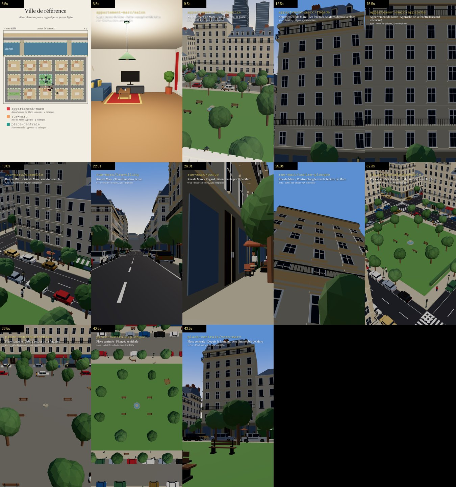

# Ville de référence de la série

Une seule ville pour tous les épisodes « Et si… ? » : mêmes rues, mêmes immeubles, même fleuve et mêmes
repères, quel que soit l'épisode. Elle réutilise le système de ville existant (générateur, registre
de 63 objets, `Shot` de `camera.ts`, `CityItem`, `CityEnvironment`) : aucun système parallèle.



## Quatre couches séparées

| Couche | Fichier | Rôle |
| --- | --- | --- |
| Monde | `public/city-layouts/ville-reference.json` | 1 451 objets générés **une fois** (graine 286, 5 × 3 îlots, options complètes dans `world.ts`), puis figés. Format habituel de l'éditeur. |
| Lieux | `src/assets/city/reference/places.ts` | `appartement-marc`, `rue-marc`, `place-centrale` : ils pointent vers des ids du monde, sans le copier. |
| Caméras | `src/assets/city/reference/shots.ts` | 4 cadrages 9:16 par lieu, de simples `Shot` (`sampleShots`, `viewAt`…). |
| Épisode | `src/assets/city/reference/episode.ts` | Lieu par identifiant, personnages et événements à part, variantes appliquées au rendu. |

Le monde est importé avec le code et **gelé** (`Object.freeze` récursif) : une écriture pendant un rendu
lève une erreur. Aucune régénération par épisode : seul `npm run city:freeze` réécrit le fichier, et
seulement si le monde de la série doit vraiment changer (tous les épisodes bougent alors).

```powershell
npm run city:freeze -- --check   # le fichier figé = la régénération (aussi vérifié par npm run test:city)
```

## Les trois lieux pilotes

| Id | Ancre | Ce que c'est | Points de placement |
| --- | --- | --- | --- |
| `appartement-marc` | `haussmann-894` | 4ᵉ étage (étage 3) de l'immeuble de 7 étages au sud de la place, trois fenêtres plein nord | `fenetre`, `canape`, `table`, `entree` |
| `rue-marc` | `road-54` | Tronçon est-ouest entre la place (nord) et l'immeuble de Marc (sud), avec le fleuriste et une terrasse | `porte-immeuble`, `trottoir-nord`, `trottoir-sud`, `terrasse`, `chaussee` |
| `place-centrale` | `fountain-832` | Square à fontaine au centre de la ville | `fontaine-sud`, `banc-ouest`, `banc-est`, `allee-est`, `entree-sud` |

Chaque lieu a une position, une orientation (`ry`, façade vers `(-sin ry, -cos ry)` comme les objets),
une zone (boîte alignée sur les rues), des points de placement, des points d'interaction (porte, fenêtres,
bancs, terrasse…) et un rayon de détail. La géographie tient ensemble : de la fenêtre de Marc on voit la
place, la fontaine, les façades d'en face, les tours de bureaux au nord et la tour Eiffel au nord-ouest.

**Intérieur.** `ApartmentInterior` dessine l'appartement dans son immeuble, au bon étage et dans la bonne
orientation (meubles de `src/assets/interior`). Le mur de façade a de vraies ouvertures en face des
fenêtres de `Building.tsx` : ce qu'on voit dehors est la ville de référence elle-même. Un cadrage
`inside: true` dessine l'intérieur et masque la coque de l'immeuble hôte.

## Utiliser un lieu dans un épisode

```tsx
import {placeShots, spot, ReferenceScene, useEpisodeSet, WeatherOverlay} from '../../assets/city/reference';

const set = useEpisodeSet({place: 'rue-marc', variants: {lighting: 'nuit', weather: 'pluie'}});
const shots = placeShots('rue-marc', {only: ['porte', 'contre-plongee'], extra: [monPlan]});
const view = sampleShots(shots, t);
const marc = spot('rue-marc', 'porte-immeuble');            // {pos, ry}

<ThreeCanvas …>
  <CameraRig position={view.pos} target={view.target} fov={view.fov} />
  <ReferenceScene set={set} inside={shots[view.index].inside}>
    <group position={marc.pos} rotation={[0, marc.ry, 0]}><Marc t={t} /></group>
  </ReferenceScene>
</ThreeCanvas>
<WeatherOverlay set={set} frame={frame} width={1080} height={1920} />
```

- `getPlace('…')`, `spot`, `interaction`, `placeShots({only})` : un identifiant inconnu lève une erreur
  qui liste les identifiants valides (`Lieu inconnu « x ». Lieux de la ville de référence : …`).
- Un épisode ajoute ses propres plans (`extra`) ; les repères urbains restent en arrière-plan puisque
  c'est toujours le même monde.
- Démonstration complète : `src/assets/city/reference/ReferenceDemo.tsx` (composition `VilleReferenceDemo`).

## Variantes propres à l'épisode

`applyVariants(monde, variantes)` construit un **nouveau** monde pour le rendu ; le fichier figé n'est jamais
modifié (vérifié par les tests).

| Variante | Effet |
| --- | --- |
| `lighting: 'jour' \| 'crepuscule' \| 'nuit'` | ciel, soleil, fenêtres et lampadaires allumés |
| `weather: 'brouillard' \| 'pluie' \| 'neige'` | ciel, brume, sol ; neige sur trottoirs, toits et feuillages ; pluie ou flocons en surimpression (`WeatherOverlay`) |
| `damage: [{center, radius, level}]` | immeubles écrêtés et noircis, voitures déplacées, arbres abîmés, petit mobilier et passants retirés (reproductible, sans hasard) |
| `changes: [{id, remove?, props?, move?}]` | modifier, déplacer ou retirer un objet du monde (id inconnu = erreur) |
| `add: [LayoutItem]` | objets apportés par l'épisode (cratère, objet géant…) ; un id existant = erreur |

## Niveau de détail

`splitDetail` garde en détail complet le lieu (ses objets, toujours) et son voisinage visible
(`detailRadius` autour de `detailCenter` : l'appartement centre son détail vers la place, côté fenêtres).
Au-delà, `FarBlocks` dessine les immeubles en quelques maillages instanciés (murs, grille de fenêtres,
toit mansardé, même emprise, hauteur et pierre) et les arbres en couronnes ; le petit mobilier, les
voitures et les passants lointains disparaissent. Le sol et les repères (fleuve, ponts, tour Eiffel,
tours) restent toujours complets.

Mesure (`npm run benchmark -- VilleReferenceVisiteSansLOD VilleReferenceVisite --frames 300`, GTX 1660 Ti) :

| Composition (300 images, rue-marc puis place-centrale) | Objets en détail | 1ᵉʳ passage | 2ᵉ passage (ordre inverse) | 3ᵉ passage (détail de rue-marc élargi) | Mémoire système |
| --- | --- | --- | --- | --- | --- |
| `VilleReferenceVisiteSansLOD` (avant : tout en détail) | 1 451 | 121 ms/image | 120 ms/image | 127 ms/image | +2,5 à +2,7 Go |
| `VilleReferenceVisite` (après : lieu + voisinage) | 610 à 694 | 90 ms/image | 93 ms/image | 93 ms/image | +2,4 Go |

Soit environ −25 % de temps de rendu par image et −200 Mo de mémoire système. Le pic mémoire de Node suit
la composition rendue en premier (préchauffage) et n'est pas comparable. Résultats bruts :
[`benchmarks/ville-reference-2026-11-03.json`](benchmarks/ville-reference-2026-11-03.json).

Sur 12 des 13 images de la visite, l'image avec simplification est identique au pixel près à l'image tout
en détail (écart moyen 0) : les objets simplifiés sont cachés ou hors champ. Seul `rue-marc/travelling`, qui
regarde l'axe de la rue sur une centaine de mètres, montre au fond des façades sans balcons (écart moyen
0,32/255, ramené de 0,73 en étirant le détail de `rue-marc` le long de la rue et en gardant les voitures
lointaines en boîtes). Pour juger leur allure, la
visite accepte un rayon forcé :

```powershell
npm run stills -- VilleReferenceVisite --frames 195,285 --props '{"detailRadius":25}'
```

## Vérifier

```powershell
npm run test:city -- reference                    # 11 tests : monde = régénération, lieux, zones, ids, caméras hors des bâtiments
npm run stills -- VilleReferenceVisite --frames 105,195,285,375,465,563,675,780,870,968,1095,1215,1305
npm run stills -- VilleReferenceDemo --frames 45,135,225,330,412,510
```

`VilleReferenceVisite` montre la carte des lieux et de leurs identifiants (5 s), puis chaque cadrage de
référence avec son id. `tourStillFrames(30)` (dans `CityTour.tsx`) redonne la liste des images ci-dessus.

## Ajouter un lieu ou un cadrage

1. Repérer les ids dans le JSON figé (ou dans l'éditeur : `npm run city`, ouvrir `ville-reference`, sans
   enregistrer).
2. Ajouter l'id à `PLACE_IDS` et sa définition dans `places.ts` (zone, points, interactions, rayon).
3. Ajouter ses cadrages dans `shots.ts` (ids `<lieu>/<plan>`, jamais renommés ensuite).
4. `npm run test:city -- reference`, puis une planche de la visite, relue image par image.

Les épisodes existants n'ont pas été migrés : leurs décors restent en place.
